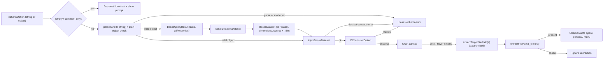

# Shared Bases dataset layer and generic ECharts view

* **Author**: Mike Kobit
* **Status**: Draft
* **Date**: 2026-11-17

## Overview

This design adds a shared serializer from Obsidian `BasesQueryResult` (`BasesEntry[]` and `BasesPropertyId[]`) to an ECharts `dataset`, and registers a generic `echarts` view type for Obsidian `.base` files and inline ```` ```base ```` code blocks.
Obsidian Bases remains the single engine for querying, filtering, formulas, and sorting.
The plugin converts the active Bases query result into an ECharts `dataset` (`dimensions`, `source`, and a `_file` note path on each row) so users can write ECharts `encode` and `dataset` transforms directly in YAML.
Existing preset chart views keep their property-picker Bases configuration UIs and remain unchanged.

## The problem

Preset chart views in `bases-chartkit` expose only a fixed set of chart types and per-chart configuration fields.
When a user needs an ECharts series type, multi-series layout, or `dataset` transform that preset view options do not expose, they cannot configure it.
Meanwhile, existing chart transformers share helpers in [`src/charts/transformers/bases-values.ts`](../../src/charts/transformers/bases-values.ts) but still convert values ad hoc, often stringifying typed values via `safeToString` and losing numeric, boolean, list, and date/time fidelity.

Adding a shared `BasesQueryResult` to ECharts `dataset` layer and exposing a generic `echarts` view inside `.base` and ```` ```base ```` blocks solves both problems:
* Users get access to declarative ECharts `encode`, `dataset` transforms, and YAML-configurable series types inside Bases views.
* Future preset view migrations gain a single typed data-serialization layer.

## Goals

* Serialize `BasesQueryResult` (`BasesEntry[]` and `BasesPropertyId[]`) into an ECharts `dataset` (`dimensions`, `source`, and per-row `_file`) while preserving native JS types (`string`, `number`, `boolean`, `null`, epoch-ms numbers from `DateValue`, and arrays from `ListValue`).
* Register a generic `echarts` Bases view for `.base` files and inline ```` ```base ```` code blocks that accepts YAML-formatted ECharts options (as a YAML string parsed via Obsidian `parseYaml` or a pre-parsed plain object from `.base` files).
* Require an explicit `id: 'bases'` entry in `userOption.dataset` and populate its `dimensions` and `source` at its declared index without mutating `userOption`; display error messages in `.bases-echarts-error` when `id: 'bases'` is missing or invalid.
* Keep note interactivity (Mod+click, Mod+hover preview, context menu) working for `dataset`-backed series via `_file` on `params.data` only (disabling `BaseChartView`'s `dataIndex` and `rowIndex` fallbacks), and ignore interactions without error when transforms drop `_file`.
* Display YAML parse errors, non-object root errors, `id: 'bases'` validation errors, and synchronous ECharts `setOption` exceptions directly in `.bases-echarts-error` instead of failing silently.
* Keep all existing preset chart views and their Bases UIs working without regression.

## Non-goals

* Standalone ```` ```echart ```` Markdown code block processor outside Bases.
* All-at-once migration of existing preset views in `src/charts/transformers/` onto `dataset` and `encode`.
* Arbitrary JavaScript evaluation (`eval` or `new Function`) in ECharts options.
* "Copy chart as PNG" clipboard export action (tracked separately as `bd` issue `bck-bc4`).
* Full structural refactoring of `src/main.ts` or [`src/views/base-chart-view.ts`](../../src/views/base-chart-view.ts) into composable helpers (tracked separately as `bd` issue `bck-0jh`); only a minimal 3-hook seam on `BaseChartView` is included here.

## Open questions

None.

## Critical user journeys (CUJs)

### CUJ 1: Author a custom ECharts view in a `.base` file or inline block

* **Given**: A vault note or `.base` file with a Bases query returning typed properties (numbers, dates, strings, booleans, tags/lists).
* **When**: The user selects the `echarts` view type and enters a YAML `EChartsOption` with `dataset: { id: 'bases' }` (or `{ id: 'bases' }` inside a `dataset` array) using `encode` or `dataset` transforms.
* **Then**: The plugin preserves native JS types so ECharts `value`, `time`, and `category` axes work as configured, renders the chart, and updates live when vault data or filters change.

### CUJ 2: Interact with notes from a dataset-backed chart

* **Given**: A rendered `echarts` view.
* **When**: The user Mod+clicks, Mod+hovers, or right-clicks a chart element whose `params.data` row includes `_file`.
* **Then**: Obsidian opens the linked note, shows the page preview, or opens the note context menu; if a user `dataset` transform or static series omits `_file`, the interaction is ignored without error.

### CUJ 3: Show an empty-option prompt before configuration

* **Given**: A newly created `echarts` view with an empty, whitespace-only, or comment-only `echartsOption`.
* **When**: The view renders.
* **Then**: The chart canvas is cleared and hidden, and a localized prompt message guides the user to add an `echartsOption` configuration.

### CUJ 4: Diagnose an invalid YAML option, dataset contract error, or `setOption` exception

* **Given**: An `echarts` view where the user enters malformed YAML, a non-object YAML root, a missing/duplicate/conflicting `id: 'bases'` dataset, or an option that throws synchronously in ECharts `setOption`.
* **When**: The view parses, validates, or renders the option.
* **Then**: The view disposes any wedged chart instance and displays the error message via `setText()` in `.bases-echarts-error` instead of rendering a blank canvas or stale chart.

## Non-functional requirements

* **Security**: `.base` files and ```` ```base ```` blocks store static YAML.
  User options are parsed only with Obsidian `parseYaml` (never `eval` or `new Function`), preventing JavaScript callback execution from YAML option strings.
  Error and prompt messages render via `setText()` rather than `innerHTML`.
  Note: ECharts' default `tooltip.renderMode: 'html'` passes static `tooltip.formatter` strings into `innerHTML`; if untrusted `.base` files are a threat model, force `tooltip.renderMode: 'richText'` when absent or document the HTML tooltip behavior.
* **Performance and scale**: `serializeBasesDataset` evaluates `entry.getValue(propId)` synchronously in `O(rows * properties)` time on `onDataUpdated()`.
  This matches existing synchronous preset transformers and requires no worker or caching layer in v1.
* **Compatibility**: Existing preset views and [`src/charts/option-override.ts`](../../src/charts/option-override.ts) remain unchanged so existing `.base` files render identically.
* **Localization**: User-facing strings (view name, option labels, empty prompt, error prefixes) use `i18next` keys under `views.echarts.*` in [`src/lang/locales/en.json`](../../src/lang/locales/en.json).

## Technical plan

### Data flow



### 1. Shared dataset serialization (`src/charts/dataset.ts`)

A pure, immutable, loop-free module transforms Obsidian `BasesEntry[]` and `BasesPropertyId[]` into an ECharts-compatible dataset (`id: 'bases'`) using `remeda`, `Temporal`, and structural duck-typing (no runtime `obsidian` imports, matching [`src/charts/transformers/bases-values.ts`](../../src/charts/transformers/bases-values.ts) so `bun test` runs without mocking `obsidian`):

* **Types**:
  * `BasesDatasetValue`: `string | number | boolean | null | readonly BasesDatasetValue[]`.
  * `BasesDatasetRow`: `Readonly<Record<string, BasesDatasetValue>>` containing `_file: string` and one entry per property ID.
  * `BasesDataset`: `{ readonly id: 'bases'; readonly dimensions: readonly string[]; readonly source: readonly BasesDatasetRow[] }`.
  * `InjectBasesDatasetResult`: `{ readonly ok: true; readonly option: EChartsOption } | { readonly ok: false; readonly error: string }`.
* **`unwrapBasesValue(val: Value | null | undefined): BasesDatasetValue`**:
  * `null`, `undefined`, `NullValue`, or `ErrorValue` -> `null`.
  * `BooleanValue` -> boolean value via `val.isTruthy()`.
  * `NumberValue` -> finite `Number(str)` when `str.trim().length > 0`, otherwise `null`.
  * `DateValue` (including `RelativeDateValue`) -> epoch milliseconds via `parseDateToEpochMs(val.toString())` from [`src/charts/transformers/dates.ts`](../../src/charts/transformers/dates.ts) (extended for `Temporal.PlainDateTime` if needed), or `null` if unparseable.
  * `ListValue` -> recursive array of unwrapped elements.
  * `StringValue`, `LinkValue`, `TagValue`, and remaining `NotNullValue` subclasses -> `val.toString()`.
  * Note: ECharts coerces raw JS arrays in `ListValue` to `NaN`/`0` on numeric dimensions and keys `OrdinalMeta` by array identity; `ListValue` is preserved as an array for custom series/transforms and documented as a v1 axis limitation.
* **`serializeBasesDataset(entries: readonly BasesEntry[], properties: readonly BasesPropertyId[]): BasesDataset`**:
  * Builds `dimensions: [...properties]` (omitting `_file` from `dimensions` so series without explicit `encode` do not plot `_file` as dimension `0`, while always emitting an explicit `dimensions` array—including `[]`—so ECharts does not auto-discover `_file` from row object keys).
  * Maps each `entry` from ungrouped `this.data.data` (ignoring `groupedData`) to `{ _file: entry.file.path, ... }` across `properties`.
  * In `EChartsView`, `properties` comes from `this.allProperties` (with `this.data.properties` ordered first) so YAML `encode` and transforms work even when `.base` files omit `order:`.
* **`injectBasesDataset(userOption: Record<string, unknown>, basesDataset: BasesDataset): InjectBasesDatasetResult`**:
  * Returns a discriminated `Result` union without throwing or mutating `userOption` (satisfying strict ESLint functional rules).
  * Normalizes `userOption.dataset` (single plain object via `isRecord` or array of plain objects) and locates the entry with `id: 'bases'`.
  * Returns `{ ok: false, error }` for:
    * Missing `userOption.dataset`, non-object/non-array `dataset`, non-object elements inside `dataset`, or no entry with `id: 'bases'`.
    * Duplicate `id: 'bases'` entries.
    * Any `id: 'bases'` entry defining `source`, `transform`, `fromDatasetIndex`, `fromDatasetId`, `fromTransformResult`, `seriesLayoutBy`, or `sourceHeader` (checked via `key in entry && entry[key] !== undefined`).
  * Returns a shallow-cloned `EChartsOption` where the `id: 'bases'` slot is replaced at its original index with `source: basesDataset.source` and `dimensions: userEntry.dimensions ?? basesDataset.dimensions` (preserving all user dataset indices).

### 2. Note interactivity (`src/charts/transformers/bases-values.ts`, `src/charts/interactivity.ts`, and `src/views/base-chart-view.ts`)

* **`extractFilePath(item)`**: Check `item._file` first (when non-empty `string`) before falling back to `filePath`, `item['file.path']`, `item.getValue('file.path')`, `file.path`, and `file`.
* **`BaseChartView` interactivity hook**: Add `protected getInteractivityData(): BasesData | undefined` in [`src/views/base-chart-view.ts`](../../src/views/base-chart-view.ts) (defaulting to `this.getBasesData()`), and pass it from `handleChartClick`, `handleChartHover`, and `handleChartContextMenu` to `extractTargetFilePaths` and `extractTargetFilePath`.
  `EChartsView` overrides `getInteractivityData()` to return `undefined`, disabling `dataIndex`, `rowIndex`, and `rowIndices` fallbacks without breaking `openFullScreen()`.

### 3. Generic `echarts` view (`src/views/echarts-view.ts`, `src/views/base-chart-view.ts`, `src/main.ts`, `src/charts/registered-views.ts`, `src/lang/locales/en.json`, and `styles.css`)

* **`BaseChartView` minimal render and options seam**:
  * Split host display options (`theme`, `height`) from preset options in `BaseChartView.getCommonViewOptions(plugin)`.
  * Extract a shared `protected` option-resolution / render-error seam (or `openFullScreen()` + `getChartOption()` contract) so normal rendering, `updateChartTheme()`, and `openFullScreen()` share the same YAML-parse, `injectBasesDataset`, and error-handling path.
* **`EChartsView extends BaseChartView`**:
  * Declares `readonly type = 'echarts'`.
  * `static getViewOptions(plugin)` exposes `echartsOption` (`type: 'text'` via `BasesTextOption`—since Obsidian `BasesOptions` has no multiline textarea option, multi-line YAML is authored directly in `.base` or ```` ```base ```` blocks), `theme`, and `height`.
  * Reads `this.config.get('echartsOption')`, accepting either a YAML string (parsed with `parseYaml` inside `try/catch`) or a pre-parsed plain object (`isRecord(val) && !Array.isArray(val)`).
  * On empty/whitespace/comment-only input, clears/disposes any chart, hides `this.chartEl`, and shows the localized prompt.
  * Guards `!this.data`, serializes `this.data?.data ?? []` and `this.allProperties ?? []`, runs `injectBasesDataset`, and calls `this.chart.setOption(option, true)` inside `try/catch`.
  * On any parse, root, dataset, or `setOption` error (using a localized fallback when `error.message` is empty), calls `this.chart?.dispose(); this.chart = null` (to avoid ECharts' `IN_EC_CYCLE_KEY` lockup), hides `this.chartEl`, and displays the message via `setText()` in `.bases-echarts-error` inside `.bases-chart-container`.
* **Registration & localization**:
  * Add `'echarts'` to `REGISTERED_CHART_VIEW_TYPES` in [`src/charts/registered-views.ts`](../../src/charts/registered-views.ts).
  * Register `EChartsView` in [`src/main.ts`](../../src/main.ts) via `this.registerBasesView('echarts', ...)` with `options: () => EChartsView.getViewOptions(this)`.
  * Add `views.echarts.*` keys to [`src/lang/locales/en.json`](../../src/lang/locales/en.json).

## Alternatives considered

### Alternative A: Standalone ```` ```echart ```` Markdown code block processor

* **Pros**: Lets users author charts anywhere in Markdown without creating a `.base` or ```` ```base ```` block.
* **Cons**: Duplicates Obsidian Bases querying, filtering, formulas, sorting, and live vault-update subscriptions inside plugin code.
* **Reason for rejection**: Keeping all charts inside `.base` and ```` ```base ```` blocks preserves Obsidian Bases as the single query engine.

### Alternative B: All-at-once rewrite of all preset views to `dataset` and `encode`

* **Pros**: Eliminates all per-chart extraction code in `src/charts/transformers/` in one pass.
* **Cons**: Rewriting 34 `ChartType` variants across 30 transformer modules (36 registered views) at once risks visual and data regressions across specialized series (`candlestick`, `boxplot`) and coordinate systems (`calendar`).
* **Reason for rejection**: Preset views will migrate incrementally onto `src/charts/dataset.ts` after the shared layer and generic `echarts` view are proven.

### Alternative C: Custom template or binding DSL inside `echartsOption`

* **Pros**: Could provide shorthand syntax for referencing Bases properties inside series objects.
* **Cons**: Adds a custom parser, documentation surface, and maintenance burden while duplicating ECharts' built-in `encode` and `dataset` transform capabilities.
* **Reason for rejection**: Populating an explicit `id: 'bases'` entry in `dataset` lets users rely on ECharts `encode` and `dataset` transforms directly.

### Alternative D: Reusing `R.mergeDeep` (`src/charts/option-override.ts`) for `dataset` injection

* **Pros**: Reuses the existing preset override helper without writing `injectBasesDataset`.
* **Cons**: `R.mergeDeep` treats `dataset` arrays/objects structurally and overwrites or corrupts user-defined `dataset` transform arrays; `applyOptionOverride` also parses JSON only and swallows parse errors silently.
* **Reason for rejection**: `injectBasesDataset` validates and replaces the explicit `id: 'bases'` entry in `userOption.dataset` at its declared index while propagating YAML, dataset validation, and `setOption` errors to the view.

### Alternative E: Implicit prepending of `basesDataset` at index `0`

* **Pros**: Saves writing `dataset: { id: 'bases' }` for simple single-dataset charts.
* **Cons**: Silently shifts user-defined `dataset` array indices (`0` becomes `1`) and hides where Bases data lives in the ECharts option.
* **Reason for rejection**: Users must declare `id: 'bases'` explicitly in `dataset` so every dataset index is visible in the YAML.

## Detailed implementation plan

### Target files to create or modify

#### 1. `src/charts/dataset.ts` (create)

* **Type and scope**: Pure TypeScript module (strict ESLint functional rules: no `throw`, no mutation, `readonly` types, no `as` casts).
* **Proposed changes**:
  * Export `BasesDatasetValue`, `BasesDatasetRow`, `BasesDataset` (all `readonly` fields), and `InjectBasesDatasetResult` (`{ readonly ok: true; readonly option: EChartsOption } | { readonly ok: false; readonly error: string }`).
  * Implement `unwrapBasesValue(val: Value | null | undefined): BasesDatasetValue` using structural duck-typing (no runtime `obsidian` imports): map nullish/`ErrorValue` to `null`, boolean wrappers via `isTruthy()`, numeric wrappers via finite `Number(str)` when `str.trim().length > 0`, date wrappers via `parseDateToEpochMs(val.toString())`, list wrappers recursively, and remaining wrappers via `val.toString()`.
  * Implement `serializeBasesDataset(entries: readonly BasesEntry[], properties: readonly BasesPropertyId[]): BasesDataset` producing `dimensions: [...properties]` and `{ _file: entry.file.path, ... }` rows.
  * Implement `injectBasesDataset(userOption: Record<string, unknown>, basesDataset: BasesDataset): InjectBasesDatasetResult` using `isRecord` from `src/charts/transformers/bases-values.ts`, validating `dataset` shape, single `id: 'bases'` presence, and absence of `source`, `transform`, `fromDatasetIndex`, `fromDatasetId`, `fromTransformResult`, `seriesLayoutBy`, and `sourceHeader`, then returning a shallow-cloned `EChartsOption` with `source` and `userEntry.dimensions ?? basesDataset.dimensions` at the `id: 'bases'` slot.

#### 2. `src/charts/transformers/bases-values.ts` (modify)

* **Type and scope**: Existing TypeScript utility module.
* **Proposed changes**:
  * Update `extractFilePath(item: unknown): string | undefined` to check `item._file` first (when `typeof item._file === 'string' && item._file.length > 0`) before `filePath`, `item['file.path']`, `item.getValue('file.path')`, `file.path`, and `file`.

#### 3. `src/views/base-chart-view.ts` (modify)

* **Type and scope**: Existing base view class (minimal 3-hook seam only; full refactor stays in `bck-0jh`).
* **Proposed changes**:
  * Extract host display options (`theme`, `height`) from `getCommonViewOptions(plugin)` so `EChartsView` does not expose duplicate `echartsOption` or dead preset controls.
  * Add `protected getInteractivityData(): BasesData | undefined` returning `this.getBasesData()` and pass it from `handleChartClick`, `handleChartHover`, and `handleChartContextMenu`.
  * Expose a `protected` render/fullscreen option seam (or `protected` `initChart`/`getTheme` + shared `openFullScreen` hook) so `EChartsView` shares YAML parsing, `injectBasesDataset`, and error handling across normal render, theme change, and fullscreen mode.

#### 4. `src/views/echarts-view.ts` (create)

* **Type and scope**: Obsidian `BasesView` subclass (`EChartsView extends BaseChartView`).
* **Proposed changes**:
  * Set `readonly type = 'echarts'`.
  * Implement `static getViewOptions(plugin)` returning the `echartsOption` (`type: 'text'`) option plus host options (`theme`, `height`).
  * Implement `getInteractivityData()` returning `undefined` (`params.data`-only interactivity).
  * Implement `getChartOption()` / render path to:
    * Read `this.config.get('echartsOption')` (string or plain object).
    * Show the localized empty-option prompt when empty, whitespace-only, or comment-only.
    * Parse YAML via `parseYaml` inside `try/catch` and verify `isRecord(parsed) && !Array.isArray(parsed)`.
    * Guard `!this.data`, call `serializeBasesDataset(this.data?.data ?? [], properties)` (using `this.allProperties` with `this.data.properties` first), and run `injectBasesDataset`.
    * Call `this.chart.setOption(option, true)` inside `try/catch`.
    * On any error, call `this.chart?.dispose(); this.chart = null`, hide `this.chartEl`, and render the localized error (with non-empty fallback when `error.message` is `''`) via `setText()` into `.bases-echarts-error`.

#### 5. `src/charts/registered-views.ts` (modify)

* **Type and scope**: View registry constant.
* **Proposed changes**:
  * Add `'echarts'` in alphabetical order to `REGISTERED_CHART_VIEW_TYPES`.

#### 6. `src/main.ts` (modify)

* **Type and scope**: Plugin entrypoint.
* **Proposed changes**:
  * Import `EChartsView` from `./views/echarts-view` and register `'echarts'` in `onload()` via `this.registerBasesView('echarts', ...)` with localized name, Lucide icon (`bar-chart-big` or `area-chart` / `code-2`), factory, and `options: () => EChartsView.getViewOptions(this)`.

#### 7. `src/lang/locales/en.json` (modify)

* **Type and scope**: Localization strings (`i18next`).
* **Proposed changes**:
  * Add sentence-case keys under `views.echarts`: `name`, `empty_option_prompt`, `error_yaml_parse`, `error_invalid_root`, `error_dataset`, and `error_render` (with `{{error}}` interpolation where applicable), reusing `views.common.echarts_option` and `views.common.echarts_option_placeholder` (or dedicated `views.echarts.option_label` / `views.echarts.option_placeholder`).

#### 8. `styles.css` (modify)

* **Type and scope**: Plugin stylesheet.
* **Proposed changes**:
  * Add `.bases-echarts-error` and `.bases-echarts-prompt` styling inside `.bases-chart-container` using Obsidian CSS variables (`--text-error`, `--text-muted`, `--background-secondary`), positioned/padded so it is not clipped by `overflow: hidden` and does not overlap `.bases-chart-toolbar`.

#### 9. `tests/charts/dataset.test.ts` (create)

* **Type and scope**: Unit tests (observing `.test-cast-budget`).
* **Proposed changes**:
  * Test `unwrapBasesValue` across nullish, `ErrorValue`, boolean, empty/finite/non-finite number, date (`Temporal` epoch-ms), recursive list, and string/link/tag duck-typed wrappers.
  * Test `serializeBasesDataset` (`dimensions` excludes `_file`, empty `properties` produces `[]`, rows include `_file` and all property values).
  * Test `injectBasesDataset` for single-object and array `userOption.dataset`, `userEntry.dimensions ?? basesDataset.dimensions`, immutability of `userOption`, and `{ ok: false, error }` cases (missing `dataset`, non-object items, missing/duplicate `id: 'bases'`, and conflicting `source`, `transform`, `fromDatasetIndex`, `fromDatasetId`, `fromTransformResult`, `seriesLayoutBy`, `sourceHeader`).

#### 10. `tests/transformer_utils.test.ts` (modify)

* **Type and scope**: Existing unit test file.
* **Proposed changes**:
  * Test `extractFilePath` priority (`_file` over `filePath`, `file.path`, `file`) and empty `_file: ''`.
  * Import `extractTargetFilePath` and assert that omitting `data` returns `undefined` when `_file` is absent while passing `data` preserves `dataIndex` fallback for preset views.

#### 11. `tests/views/echarts-view.test.ts` (create)

* **Type and scope**: Unit tests (kebab-case filename, mocking `obsidian` via `yaml` package and `echarts` / minimal DOM stubs, or testing extracted view-controller helpers without `as` casts).
* **Proposed changes**:
  * Test empty/whitespace/comment-only prompt state, YAML string vs plain-object `echartsOption`, `.bases-echarts-error` rendering on parse/root/dataset/`setOption` errors, chart disposal on `setOption` throw, `getInteractivityData()` returning `undefined`, and successful `setOption` calls.

### Verification plan

* **Checks and unit tests**: `mise run check` (runs `typecheck`, `lint`, `check:eslint-disable-budget`, `check:test-cast-budget`, `openspec:validate`, and `bun test` unit tests).
* **Build**: `mise run build` (runs `typecheck` and `build:bundle`).
* **E2E and integration**: `mise run test:e2e:headless` (verifies `'echarts'` view registration and rendering from `REGISTERED_CHART_VIEW_TYPES` in Obsidian).
